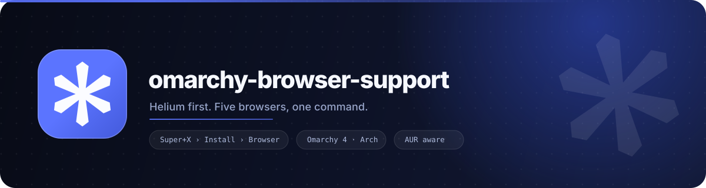
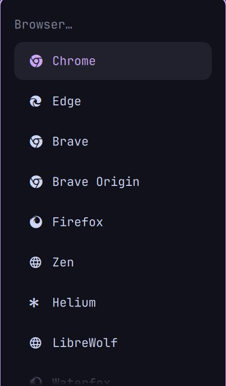

<div align="center">

<picture>
  <source media="(prefers-color-scheme: dark)" srcset="assets/readme/banner-dark.svg">
  <source media="(prefers-color-scheme: light)" srcset="assets/readme/banner-light.svg">
  
</picture>

<br>

**Helium first. Five browsers, one command.**

Bring [Helium](https://helium.computer), LibreWolf, Waterfox, Vivaldi and Floorp to
[Omarchy](https://omarchy.org) — installed, removed and switched from the same
`Super+X` menu Omarchy already uses.

[](https://omarchy.org)
[](https://archlinux.org)
[](LICENSE)
[](tests/run.sh)
[](bin/omarchy-browsers)

</div>

---

## Helium, first-class

<div align="center">
  
</div>

[Helium](https://helium.computer) is a Chromium-based browser built around
privacy and a deliberately quiet interface. Omarchy ships `helium-browser-bin`
in its repository, but its menu only knows the stock browsers — so Helium never
got a row.

This project fixes that. Helium is the flagship here: its menu rows carry the
real starburst from the official app icon (rendered by a tiny bundled font), and
it is the first entry in every table, every hint and every test.

```bash
omarchy-browsers install helium
omarchy-browsers default helium
```

<div align="center">
  
  <br>
  <sub><b>Real screenshot</b> — the managed block inside Omarchy's own menu.</sub>
</div>

## The five browsers

| | Browser | Package | Source | Command | Profile paths purged by `--purge` |
|---|---|---|---|---|---|
|  | **Helium** | `helium-browser-bin` | Omarchy repo | `helium-browser` | `.config/helium` `.local/share/helium` `.cache/helium` |
| | **LibreWolf** | `librewolf` | official repo | `librewolf` | `.librewolf` `.config/librewolf` `.cache/librewolf` |
| | **Waterfox** | `waterfox-bin` | AUR | `waterfox` | `.waterfox` `.config/waterfox` `.local/share/waterfox` `.cache/waterfox` |
| | **Vivaldi** | `vivaldi` + `vivaldi-ffmpeg-codecs` | official repo | `vivaldi` | `.config/vivaldi` `.cache/vivaldi` `.local/share/vivaldi` |
| | **Floorp** | `floorp-bin` | AUR | `floorp` | `.floorp` `.config/floorp` `.cache/floorp` |

Omarchy's stock browsers — Chromium, Chrome, Brave, Brave Origin, Edge, Firefox
and Zen — stay in the default-browser list too. Nothing here replaces them.

## Install

```bash
git clone https://github.com/hembramnishant50-glitch/omarchy-browser-support.git
cd omarchy-browser-support

./install.sh                  # link the CLI + write the menu rows
omarchy-browsers install helium
omarchy-browsers default helium
```

`install.sh` creates a symlink in `~/.local/bin`, so a later `git pull` updates
the tool in place. It then runs `menu setup`, which installs the Helium icon
font and writes the managed menu block.

**Restart the Omarchy shell once** (or log out and back in) after the first
`menu setup` so Qt loads `OmarchyHeliumIcon`. The menu rows themselves appear
immediately — it is only the starburst that waits for the font cache.

<details>
<summary><b>install.sh options</b></summary>

| Option | Effect |
|---|---|
| `--no-menu` | only create the symlink; run `menu setup` yourself later |
| `--bin-dir DIR` | link somewhere other than `$XDG_BIN_HOME` / `~/.local/bin` |
| `--dry-run` | print every action, change nothing |

</details>

## Commands

```text
omarchy-browsers <command> [options]
```

| Command | What it does |
|---|---|
| `install <name…>` | install one or more browsers; `all` installs the whole registry |
| `remove <name…>` | uninstall them; add `--purge` to wipe their profile data |
| `default [<name>]` | print the default browser, or make `<name>` the default |
| `status [--json]` | installed? default? which `.desktop` owns `http(s)`? |
| `list` | the managed registry (alias: `ls`) |
| `menu setup` | install the icon font and (re)write the managed menu block |
| `menu teardown` | remove the block and the font; leave browsers alone |
| `menu status` | where the menu file is, and whether the block validates |
| `doctor` | environment, menu, default-browser and package diagnostics |
| `version` | tool, Omarchy and registry versions |
| `help` | the full surface |

Global options work before or after the command:

| Option | Effect |
|---|---|
| `--dry-run` | print the commands that would run, change nothing |
| `--no-color` | plain output (also honours `NO_COLOR`) |

A few examples:

```bash
omarchy-browsers status                 # yes/no, ✓ on the current default
omarchy-browsers --dry-run install all  # rehearse a full install
omarchy-browsers remove waterfox --purge
omarchy-browsers default                # prints e.g. helium.desktop
omarchy-browsers status --json | jq .   # stable schema for scripts
```

`status --json` emits a `schema: 1` document with `omarchy_version`,
`default_browser` and one object per browser (`packages`, `source`, `command`,
`desktop`, `installed`, `default`).

## The Omarchy menu

`menu setup` owns exactly one marked block inside
`~/.config/omarchy/extensions/omarchy-menu.jsonc`:

```text
Super+X › Install › Browser          one row per browser, hidden once installed
Super+X › Remove  › Browser          one row per browser, hidden once removed
Super+X › Setup › Defaults › Browser one row per browser, ✓ on the current one
```

Everything outside the two marker comments is left untouched, so your own menu
tweaks survive every run. The block is regenerated from the registry, written
atomically, skipped when nothing changed, and validated against Omarchy's own
`MenuModel.js` before it replaces the live file — an invalid merge leaves the
menu alone.

<details>
<summary><b>Why the icon font?</b></summary>

Omarchy renders a menu row's `icon` field as *text* in the row font, so an image
is impossible. A row can override the family with `iconFont`, so
`assets/OmarchyHeliumIcon.ttf` provides a single glyph — `U+E00B`, a private-use
codepoint Nerd Fonts never use — with the official starburst outline. It is
installed to `$XDG_DATA_HOME/fonts`, refreshed with `fc-cache`, and removed by
`menu teardown`.

The font is byte-reproducible: `assets/build-helium-icon-font.py` rebuilds it
from `assets/helium-app-icon.svg` with `fontTools`. Details in
[docs/helium-icon.md](docs/helium-icon.md).

</details>

## Safety

- **Nothing under `/usr/share/omarchy` is ever written to.** Everything lives in
  your home directory.
- The only files touched are `~/.config/omarchy/extensions/omarchy-menu.jsonc`
  (inside the markers), `~/.local/share/fonts/OmarchyHeliumIcon.ttf`, and the
  `~/.local/bin/omarchy-browsers` symlink.
- Packages come from the official repositories or the AUR (`omarchy pkg add`,
  `omarchy pkg aur add`). Nothing is built from source here.
- `remove` hands the default-browser role to a survivor before uninstalling, and
  only `--purge` deletes profile data — with every path checked to stay inside
  `$HOME`.
- `uninstall.sh` removes the link only when it points back at this checkout.

## How it works

```text
bin/omarchy-browsers   one dispatcher: parsing, help, exit codes
lib/browsers.tsv       the registry — 10 tab-separated columns per browser
lib/core.sh            registry loader, install/remove/default/status
lib/menu.sh            managed block, icon font, atomic write, validation
lib/doctor.sh          diagnostics with ok / warn / fail
assets/                Helium art + the one-glyph icon font
tests/                 hermetic suites with a fake Omarchy tree
```

Every menu row, package list, glyph and purge path is generated from
`lib/browsers.tsv`, so adding a browser is a one-line change plus
`menu setup`. The format, validation rules and test contract are documented in
[docs/architecture.md](docs/architecture.md) and
[docs/adding-a-browser.md](docs/adding-a-browser.md).

## Troubleshooting

| Symptom | Fix |
|---|---|
| Helium shows a box/tofu in the menu | `omarchy-browsers menu setup`, then restart the shell once (`omarchy-restart-shell`) |
| The Browser submenus are empty | `omarchy-browsers menu setup` |
| Rows point at an old path | you moved the checkout — rerun `menu setup` |
| A browser is installed but not in Defaults | log out and back in so its `.desktop` entry is indexed |
| No default browser | `omarchy-browsers default helium` |
| Something else | `omarchy-browsers doctor` |

`doctor` exits non-zero only on real failures; warnings (missing `node`,
unreachable AUR, no default browser) are survivable. More in
[docs/troubleshooting.md](docs/troubleshooting.md).

## Development

```bash
tests/run.sh                      # 9 suites, 155 checks, sandboxed HOME
tests/run.sh menu --verbose       # one suite, full output
tests/run.sh --list               # what is there
make check                        # shellcheck + bash -n + tests (when installed)
```

The suites build a throwaway `HOME`, a stub `omarchy`, `pacman`, `xdg-*` and
`fc-cache`, and a fixture copy of Omarchy's menu model — so they never touch the
real system and never require Omarchy to be installed. See
[CONTRIBUTING.md](CONTRIBUTING.md).

## Uninstall

```bash
./uninstall.sh                 # remove the menu rows + the symlink
./uninstall.sh --keep-menu     # keep the menu integration
omarchy-browsers remove all --purge   # also uninstall the browsers
```

## Docs

| Document | Contents |
|---|---|
| [docs/architecture.md](docs/architecture.md) | layout, data flow, registry contract, invariants |
| [docs/adding-a-browser.md](docs/adding-a-browser.md) | add a browser end to end, with the checks to run |
| [docs/troubleshooting.md](docs/troubleshooting.md) | every symptom and its fix |
| [docs/helium-icon.md](docs/helium-icon.md) | the glyph, the font build, Qt's cache |
| [CHANGELOG.md](CHANGELOG.md) | release history |
| [CONTRIBUTING.md](CONTRIBUTING.md) | tests, style, pull requests |

## Credits

- [Omarchy](https://omarchy.org) and DHH for the desktop, its menu model and
  `omarchy-pkg-*` helpers.
- [Helium](https://helium.computer) for the browser and the official app icon
  used by the menu font and the README art.
- The LibreWolf, Waterfox, Vivaldi and Floorp projects.

<div align="center">
  <sub>MIT licensed · built for Omarchy 4.x on Arch Linux · not affiliated with Omarchy, Helium or any browser vendor</sub>
</div>
